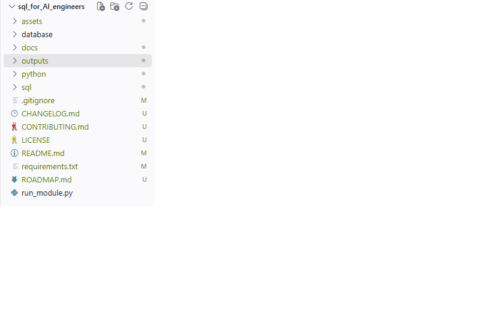

# SQL for AI Engineers 🚀

A comprehensive SQL learning repository with SQL scripts, Python (`sqlite3`) implementations, documentation, and automated execution—designed specifically for AI Engineers.


SQL is one of the core skills required for modern AI Engineers.

This repository prepares you for building:

- Machine Learning Applications
- Data Engineering Pipelines
- Retrieval-Augmented Generation (RAG)
- AI Chatbots
- Agentic AI Systems
- Multi-Agent Workflows
- FastAPI Backend Services
- Document Management Systems
- Vector Database Metadata Storage
- AI Conversation History

Each module includes:

- SQL implementation
- Equivalent Python (`sqlite3`) implementation
- Documentation
- Automated execution using `run_module.py`
- Execution output logs

## 📑 Table of Contents

- [Project Overview](#-sql-for-ai-engineers-)
- [Project Goal](#-project-goal)
- [Technology Stack](#-technology-stack)
- [Why SQLite?](#-why-sqlite)
- [Repository Structure](#-repository-structure)
- [Project Screenshots](#-project-screenshots)
- [Setup Instructions](#️-setup-instructions)
- [Running the Project](#️-running-the-project)
- [Learning Modules](#-learning-modules)
- [Connection With AI Engineering](#-connection-with-ai-engineering)
- [Future Integration Goals](#-future-integration-goals)
- [Long-Term Roadmap](#-long-term-roadmap)
- [Learning Progress](#-learning-progress)
- [Repository Achievements](#-repository-achievements)
- [Features](#-features)
- [Repository Statistics](#-repository-statistics)
- [Upcoming Modules](#-upcoming-modules)
- [Ideal For](#-ideal-for)
- [Support](#-support)
- [License](#-license)
- [Topics](#-topics)
- [Author](#-author)

---

# 🎯 Project Goal

Modern AI Engineers need more than LLM knowledge. Strong database skills are required for:

- Storing application data
- Managing user information
- Building AI application backends
- Creating RAG pipelines
- Managing document metadata
- Tracking conversations and AI workflows
- Designing scalable AI systems

This project builds SQL skills from beginner to advanced level through practical implementation.

---

# 🛠️ Technology Stack

| Technology | Purpose |
|---|---|
| Python | Execute SQL operations programmatically |
| SQLite | Lightweight relational database |
| SQL | Database queries and management |
| VS Code | Development environment |
| Git & GitHub | Version control and portfolio |

---

# ❓ Why SQLite?

SQLite is used throughout this repository because:

- No installation required
- Cross-platform
- Lightweight and fast
- Beginner friendly
- Supports most SQL concepts
- Perfect for learning SQL before moving to MySQL, PostgreSQL, or SQL Server

> **Note**
>
> SQLite does not support some SQL Server or MySQL features such as:
>
> - Stored Procedures
> - RIGHT JOIN
> - FULL JOIN
> - SEQUENCE
> - Clustered Index
>
> Wherever these features are unavailable, this repository demonstrates SQLite-compatible alternatives while preserving the original SQL concept.

---

# 📂 Repository Structure

```
sql-for-ai-engineers/

├── database/
│   ├── company.db
│   └── backup/
│
├── docs/
│   ├── Module_01_Database.md
│   ├── Module_02_Tables.md
│   ├── ...
│   └── Module_10_SQL_Functions.md
│
├── outputs/
│   ├── Module_01_Database.txt
│   ├── Module_02_Tables.txt
│   └── ...
│
├── python/
│   ├── config.py
│   ├── Module_01_Database/
│   ├── ...
│   └── Module_10_SQL_Functions/
│
├── sql/
│   ├── Module_01_Database/
│   ├── ...
│   └── Module_10_SQL_Functions/
│
├── run_module.py
├── requirements.txt
└── README.md
```

---

# 📸 Project Screenshots

## Module Execution


## Repository Structure


---

# ⚙️ Setup Instructions

## 1. Clone Repository

```bash
git clone https://github.com/<username>/sql-for-ai-engineers.git
```

Move into project:

```bash
cd sql-for-ai-engineers
```

---

## 2. Create Virtual Environment

Windows:

```bash
python -m venv .venv
```

Activate:

```bash
.venv\Scripts\activate
```

---

## 3. Install Requirements

```bash
pip install -r requirements.txt
```

---

# ▶️ Running the Project

Run all examples through the automation script:

```bash
python run_module.py
```

Select the required module:

Example:

```
Available Modules

1. Module_01_Database

Select Module Number: 1
```

The execution output will be saved automatically:

```
outputs/
└── Module_01_Database/
    └── output.txt
```

---

# 📚 Learning Modules

## ✅ Module 01: SQL Database Management

- Create Database
- Show Database
- Select Database
- Rename Database
- Backup Database
- Drop Database

---

## ✅ Module 02: SQL Tables

- Create Table
- Show Tables
- Rename Table
- Truncate Table (SQLite Equivalent)
- Clone Tables
- Temporary Tables
- Alter Tables
- Constraints
- Delete Table Data
- Drop Tables

---

## ✅ Module 03: SQL Queries

- Insert Sample Data
- INSERT
- SELECT
- SELECT INTO (SQLite Equivalent)
- INSERT INTO SELECT
- UPDATE
- DELETE
- ORDER BY

---

## ✅ Module 04: SQL Views

- Create Views
- Update Views (SQLite Equivalent)
- Drop Views
- Rename Views (SQLite Equivalent)

---

## ✅ Module 05: SQL Operators and Clauses 

- WHERE Clause
- TOP / LIMIT Clause
- DISTINCT Clause
- ORDER BY Clause
- GROUP BY Clause
- HAVING Clause
- AND & OR Operators
- BOOLEAN Operator
- LIKE Operator
- IN Operator
- ANY / ALL Operators
- EXISTS Operator
- CASE Expression
- NOT Operator
- NOT EQUAL Operator
- IS NULL
- IS NOT NULL
- NOT NULL Constraint
- BETWEEN Operator
- UNION Operator
- UNION vs UNION ALL
- INTERSECT Operator
- EXCEPT Operator
- Aliases

---

## ✅ Module 06: SQL Joins 

- USING JOIN
- INNER JOIN
- LEFT JOIN
- RIGHT JOIN
- CROSS JOIN
- FULL JOIN
- SELF JOIN
- DELETE JOIN
- UPDATE JOIN
- LEFT JOIN vs RIGHT JOIN
- UNION vs JOIN

> *RIGHT JOIN and FULL JOIN are demonstrated using SQLite-compatible alternatives.

---

## ✅ Module 07: SQL Keys 

- UNIQUE Key
- PRIMARY Key
- FOREIGN Key
- Composite Key
- Alternate Key

---

## ✅ Module 08: SQL Indexes 

- SQL Indexes
- Create Index
- Drop Index
- Show Indexes
- Unique Index
- Clustered Index
- Non-Clustered Index

---

## ✅ Module 09: Advanced SQL 

- Wildcards
- SQL Injection
- SQL Hosting
- MIN & MAX
- NULL Functions
- CHECK Constraint
- DEFAULT Constraint
- Stored Procedures (SQLite Equivalent)
- NULL Values
- Transactions
- Sub Queries
- Handling Duplicates
- Sequences (SQLite Equivalent)
- AUTO INCREMENT
- Date & Time Functions
- Cursors (SQLite Equivalent)
- Common Table Expression (CTE)
- GROUP BY vs ORDER BY
- IN vs EXISTS
- Database Tuning

---

## ✅ Module 10: SQL Functions

- Date Functions
- String Functions
- Aggregate Functions
- Numeric Functions
- Text & Image Functions
- Statistical Functions
- Logical Functions
- Cursor Functions (SQLite Equivalent)
- JSON Functions
- Conversion Functions
- Datatype Functions

---

# 🤖 Connection With AI Engineering

SQL knowledge is important for building:

## RAG Applications

Example:

```
                 User
                   │
             AI Application
                   │
               FastAPI API
                   │
        ┌──────────┴──────────┐
        │                     │
   SQL Database         Vector Database
        │                     │
 Users • Chats          Embeddings
 Projects               Chunks
 Metadata               Similarity Search
        └──────────┬──────────┘
                   │
                  LLM
                   │
               AI Response
```

SQL stores:

- Users
- Projects
- Documents
- Chat History
- Permissions
- AI Agent Tasks

---

# 🔥 Future Integration Goals

This repository will later connect with:

- Python Data Processing
- SQLAlchemy
- FastAPI
- LangChain
- LangGraph
- RAG Applications
- Agentic AI Systems
- Vector Databases

---

# 🌟 Long-Term Roadmap

This repository is the SQL foundation for a complete AI Engineering learning series.

Future repositories include:

- Python for AI Engineers
- FastAPI for AI
- SQLAlchemy ORM
- PostgreSQL
- LangChain
- LangGraph
- RAG Systems
- Agentic AI
- Production AI Applications

---

# 📈 Learning Progress

| Module | Status |
|---------|--------|
| Module 01 - SQL Database | ✅ Completed |
| Module 02 - SQL Tables | ✅ Completed |
| Module 03 - SQL Queries | ✅ Completed |
| Module 04 - SQL Views | ✅ Completed |
| Module 05 - SQL Operators | ✅ Completed |
| Module 06 - SQL Joins | ✅ Completed |
| Module 07 - SQL Keys | ✅ Completed |
| Module 08 - SQL Indexes | ✅ Completed |
| Module 09 - Advanced SQL | ✅ Completed |
| Module 10 - SQL Functions | ✅ Completed |

---

# 🏆 Repository Achievements

✔ 10 Completed Modules
✔ 110+ SQL Examples
✔ 110+ Python (`sqlite3`) Examples
✔ Automated Module Runner
✔ SQLite-Compatible SQL Implementations
✔ AI Engineering Focused Learning Path

---

# ✨ Features

- 100+ SQL examples
- Equivalent Python (`sqlite3`) implementation
- Module-wise documentation
- Automated execution using `run_module.py`
- Execution logs for every module
- SQLite-compatible alternatives for unsupported SQL features
- AI Engineer focused learning path
- Beginner-friendly code with practical examples

---

# 📊 Repository Statistics

- 110+ SQL examples
- 110+ Python (`sqlite3`) examples
- 10 complete learning modules
- Module-wise documentation
- Automated execution runner
- SQLite-compatible implementations
- AI Engineer–focused examples
- Beginner-friendly explanations
- Consistent SQL ↔ Python comparison

---

# 🚀 Upcoming Modules

- Module 11 – SQL Window Functions
- Module 12 – SQL Triggers
- Module 13 – SQL Stored Procedures (SQL Server)
- Module 14 – SQL Transactions (Advanced)
- Module 15 – SQL Performance Optimization
- Module 16 – SQL Interview Questions
- Module 17 – SQL + Pandas
- Module 18 – SQLAlchemy ORM
- Module 19 – PostgreSQL for AI
- Module 20 – SQL in RAG & AI Applications

---

# 💼 Ideal For

This repository is useful for:

- Students
- Software Engineers
- Data Engineers
- Machine Learning Engineers
- Generative AI Engineers
- AI Application Developers
- Anyone preparing for SQL interviews

---

# ⭐ Support

If this repository helps you learn SQL for AI Engineering, consider giving it a ⭐ on GitHub.

It helps others discover the project and motivates future improvements.

---

# 📄 License

This project is released under the MIT License.

You are free to use it for learning, teaching, and personal projects.

---

# 🏷️ Topics

SQL • SQLite • Python • Database • AI • RAG • LangChain • FastAPI • Data Engineering • Machine Learning • Generative AI

---

# 👨‍💻 Author

**Mohamed Kalid**

AI Engineer specializing in Python, SQL, Generative AI, Retrieval-Augmented Generation (RAG), and Agentic AI Systems.

- GitHub: https://github.com/MohamedKalid-94
- LinkedIn: https://www.linkedin.com/in/mohamed-kalid-4618921a7