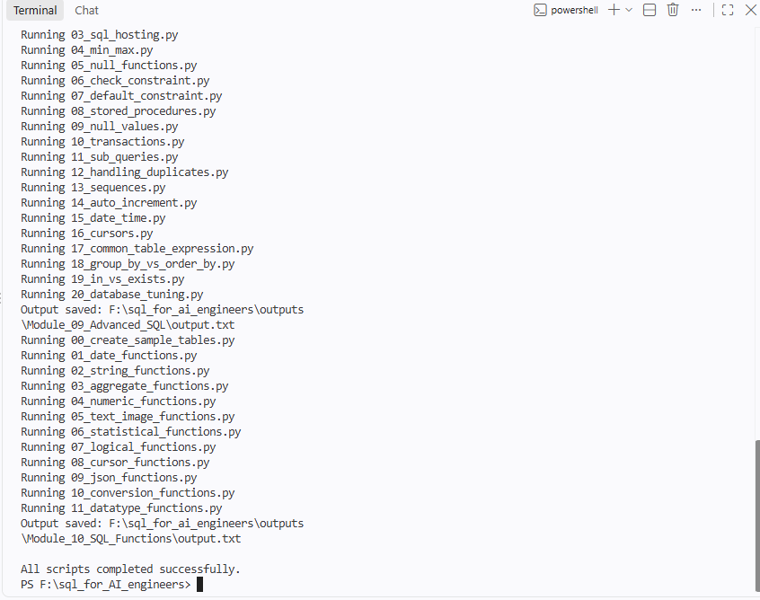

# SQL for AI Engineers

Learn SQL by running it. Every lesson is a pair of files: a `.sql` file with the queries and a `.py` file that runs them with Python's built-in `sqlite3` module. One command runs a single module or the whole course, and saves what every lesson printed.




## Why SQL matters for AI engineering

AI applications store users, documents, chat history, evaluation results and agent tasks. Most of that lives in a relational database. This course covers the SQL those applications rely on: joins, constraints, indexes, transactions, parameterized queries (the defence against SQL injection), JSON functions and recursive CTEs. The next modules add window functions and a complete schema for an AI application.

```text
                 User
                   │
             AI Application
                   │
               FastAPI API
                   │
        ┌──────────┴──────────┐
        │                     │
   SQL Database         Vector Database
 users, chats, files    embeddings, chunks
        └──────────┬──────────┘
                   │
                  LLM
```

## Quick start

```bash
git clone https://github.com/MohamedKalid-94/sql-for-ai-engineers.git
cd sql-for-ai-engineers
```

Nothing needs installing: the course uses only Python's standard library.

```bash
python run_module.py          # shows a menu
python run_module.py 6        # runs Module 6 only
python run_module.py --all    # runs all ten modules
```

What each lesson printed is saved in `outputs/<module>/output.txt`. The files are committed, so you can read the results without running anything. Lines that say `Rejected:` are intentional: the lesson is showing a rule refusing bad data.

## How it works

- Every lesson has a `.sql` file and a `.py` file with the same name. The `.py` file loads its SQL with `read_statements(__file__)` from `python/config.py`, so each query is written once.
- The runner gives every module its own fresh database. Modules 3 to 10 start with the same `employees` and `departments` tables, built from `sql/common/schema.sql` and `sql/common/seed.sql`. Modules 1 and 2 start empty because they teach how to create databases and tables.
- Results are deterministic: fixed dates, sorted rows, and file names instead of local paths, so running a module twice gives identical output.
- The `.sql` files are written to be read next to the Python, not run on their own. Some statements are rejected on purpose.

## Repository structure

```text
sql-for-ai-engineers/
├── run_module.py        runs one module or all modules
├── python/
│   ├── config.py        paths, connection helper, read_statements()
│   └── Module_01_Database/ ... Module_10_SQL_Functions/
├── sql/
│   ├── common/          shared schema.sql and seed.sql
│   └── Module_01_Database/ ... Module_10_SQL_Functions/
├── outputs/             one output.txt per module
├── docs/                notes for each module
├── assets/              screenshots
├── database/            created on the first run (*.db files are not committed)
├── requirements.txt
└── CHANGELOG.md, CONTRIBUTING.md, ROADMAP.md, LICENSE
```

## Modules

112 runnable scripts across 10 modules.

| Module | Scripts | What you learn |
|---|---|---|
| 01 Database | 6 | create, show, select, rename, backup and drop a database (in SQLite, a database is one file) |
| 02 Tables | 10 | create, alter, clone, temporary tables, constraints, truncate and drop |
| 03 Queries | 8 | INSERT, SELECT, UPDATE, DELETE, ORDER BY, INSERT INTO SELECT |
| 04 Views | 4 | create, change, rename and drop saved queries |
| 05 Operators and Clauses | 25 | WHERE, GROUP BY, HAVING, LIKE, CASE, NULL, UNION, INTERSECT, EXCEPT, aliases |
| 06 Joins | 12 | inner, left, right, full, cross and self joins, update and delete with joins |
| 07 Keys | 6 | unique, primary, foreign, composite and alternate keys |
| 08 Indexes | 8 | creating indexes and reading query plans (SCAN versus SEARCH) |
| 09 Advanced SQL | 21 | SQL injection, transactions, subqueries, CTEs, duplicates, dates, tuning |
| 10 SQL Functions | 12 | date, string, numeric, aggregate, statistical, JSON, conversion and type functions |

## SQLite compared with MySQL and SQL Server

Where SQLite lacks a command, the lesson shows the equivalent.

| Other databases | In SQLite |
|---|---|
| `CREATE DATABASE`, `USE`, `DROP DATABASE` | one file per database, `ATTACH`, `PRAGMA database_list`, delete the file |
| `TRUNCATE TABLE` | `DELETE FROM` plus resetting `sqlite_sequence` |
| `SELECT ... INTO` | `CREATE TABLE ... AS SELECT` |
| `ALTER VIEW` | `DROP VIEW` then `CREATE VIEW` |
| `RIGHT JOIN`, `FULL JOIN` | supported from SQLite 3.39; the lessons also show the older way |
| `UPDATE` or `DELETE` with `JOIN` | `UPDATE ... FROM` (3.33+) or a subquery |
| stored procedures | Python functions with named parameters, and `create_function` |
| sequences | a counter table, or `AUTOINCREMENT` |
| clustered index | `INTEGER PRIMARY KEY` or a `WITHOUT ROWID` table |
| `TEXT` and `IMAGE` types | `TEXT` and `BLOB` |

## Requirements

- Python 3.12 (the version the course was tested on)
- SQLite 3.35 or newer, which comes with Python. Check yours with `python -c "import sqlite3; print(sqlite3.sqlite_version)"`. Native RIGHT and FULL JOIN need 3.39, and the lessons say so if your version is older.

## Troubleshooting

- `FileNotFoundError: ... schema.sql`: the folder `sql/common/` is missing from your copy.
- `no such table` when running a script by hand: scripts expect the runner to build their database first. Use `python run_module.py <number>`.
- `PermissionError` on Windows: another program (such as a database viewer) has a `.db` file open. Close it and run again.

## Roadmap

- Module 11: window functions
- Module 12: a complete SQL schema for an AI application (documents, chunks, conversations, messages)
- Later: SQL with pandas, SQLAlchemy, PostgreSQL

## License

MIT, see `LICENSE`.

## Author

Mohamed Kalid, building AI engineering skills in Python, SQL, generative AI, RAG and agentic AI.

- GitHub: https://github.com/MohamedKalid-94
- LinkedIn: https://www.linkedin.com/in/mohamed-kalid-4618921a7